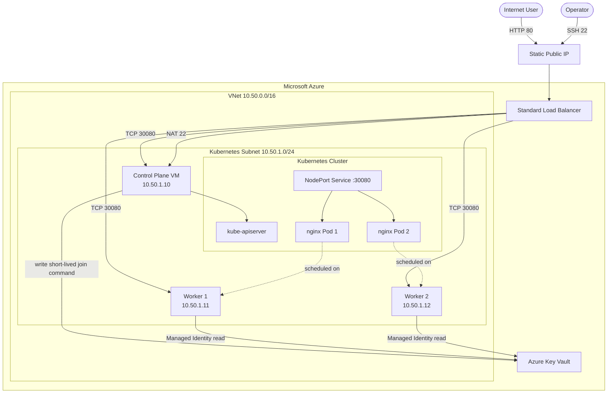
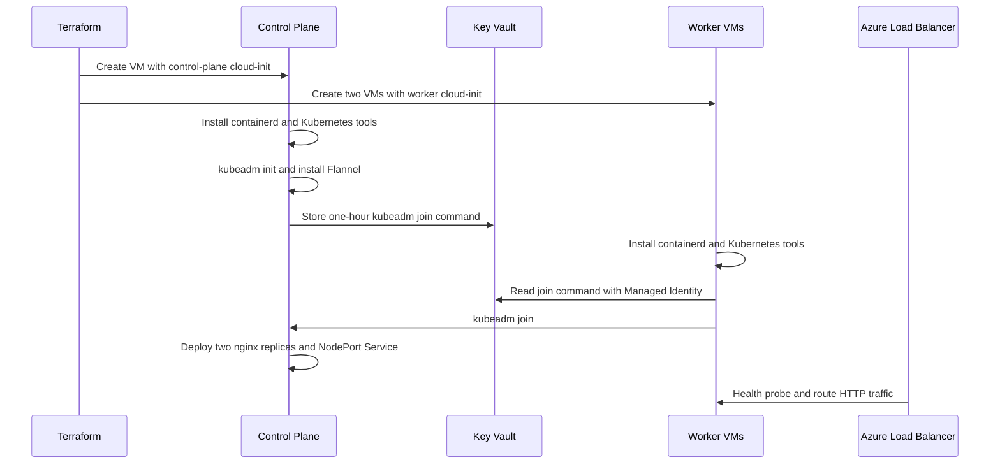

# Azure Multi-Node Kubernetes Lab with kubeadm

<p align="center">
  
  
  
  
  
</p>

This portfolio project uses Terraform and cloud-init to build a self-managed, multi-node Kubernetes cluster on Microsoft Azure. The cluster contains one control-plane VM and two worker VMs. `kubeadm` bootstraps Kubernetes, containerd runs the containers, Flannel provides Pod networking, and an Azure Load Balancer exposes a two-replica nginx application to the Internet.

## Architecture



## Cluster layout

| Node | Private IP | Size | Role |
|---|---:|---|---|
| `k8s-control` | `10.50.1.10` | `Standard_B2as_v2` | API server, scheduler, controller manager and etcd |
| `k8s-worker-1` | `10.50.1.11` | `Standard_B2as_v2` | Application workloads |
| `k8s-worker-2` | `10.50.1.12` | `Standard_B2as_v2` | Application workloads |

The three VMs consume six regional vCPUs, matching the observed Azure for Students quota in Denmark East. This leaves no vCPU headroom for another VM in the same region while the cluster is running.

## Automated bootstrap flow



## Security decisions

- Worker VMs have no public IP addresses.
- One Standard Public IP is shared by the Load Balancer.
- SSH and Kubernetes API access are restricted to `operator_cidr`.
- VM password authentication is disabled.
- Each VM has a system-assigned Managed Identity.
- The control-plane identity receives `Key Vault Secrets Officer` only on the lab vault.
- Worker identities receive `Key Vault Secrets User` only on the lab vault.
- The kubeadm join command is generated at runtime, expires after one hour and is not stored in Terraform state.
- Kubernetes internal traffic remains inside the VNet.

## Application

The Kubernetes manifest creates:

- One ConfigMap containing the HTML page.
- One Deployment with two nginx replicas.
- Resource requests and limits.
- Readiness and liveness probes.
- Required Pod anti-affinity across `kubernetes.io/hostname`.
- One NodePort Service using port `30080`.

The Azure Load Balancer maps public port `80` to NodePort `30080`.

```text
Browser -> Load Balancer :80 -> Node :30080
        -> Kubernetes Service -> nginx Pod
```

## Repository structure

```text
azure-kubeadm-multinode-lab/
|-- cloud-init/
|   |-- control-plane.yaml.tftpl
|   `-- worker.yaml.tftpl
|-- terraform.tf
|-- variables.tf
|-- locals.tf
|-- outputs.tf
|-- terraform.tfvars.example
|-- azurerm.resource_group.lab.tf
|-- azurerm.virtual_network.cluster.tf
|-- azurerm.subnet.nodes.tf
|-- azurerm.network_security_group.nodes.tf
|-- azurerm.public_ip.load_balancer.tf
|-- azurerm.lb.cluster.tf
|-- azurerm.lb_backend_address_pool.nodes.tf
|-- azurerm.lb_probe.http.tf
|-- azurerm.lb_rule.http.tf
|-- azurerm.lb_outbound_rule.nodes.tf
|-- azurerm.lb_nat_rule.ssh.tf
|-- azurerm.lb_nat_rule.api.tf
|-- azurerm.key_vault.cluster.tf
|-- azurerm.network_interface.control_plane.tf
|-- azurerm.network_interface.worker.tf
|-- azurerm.linux_virtual_machine.control_plane.tf
|-- azurerm.linux_virtual_machine.worker.tf
|-- azurerm.role_assignment.control_plane_secrets_officer.tf
`-- azurerm.role_assignment.worker_secrets_user.tf
```

Terraform loads all `.tf` files as one root module. References between resources determine deployment order.

## Configure

```powershell
cd "D:\iskagkos\OneDrive - iΚnowΗealth\Desktop\azure-kubeadm-multinode-lab"
Copy-Item .\terraform.tfvars.example .\terraform.tfvars
```

Get the account and network values:

```powershell
az account show --query "{subscription:id, tenant:tenantId}" -o table
(Invoke-RestMethod -Uri "https://api.ipify.org") + "/32"
Get-Content $HOME\.ssh\id_ed25519.pub
```

If the public key ends with a Windows comment containing `\`, copy only the first two fields:

```hcl
admin_ssh_public_key = "ssh-ed25519 AAAAC3..."
```

`name_suffix` must contain 3-8 lowercase letters or numbers because the Key Vault name must be globally unique.

## Deploy manually

No Terraform initialization, plan or apply was run while this project was created.

```powershell
terraform init
terraform fmt -check -recursive
terraform validate
terraform plan -out=tfplan
terraform show tfplan
terraform apply tfplan
```

The infrastructure can finish before cloud-init and kubeadm finish. Allow approximately 10-20 minutes for package downloads, RBAC propagation, cluster initialization and image pulls.

## Verify

Get the website URL and SSH command:

```powershell
terraform output -raw website_url
terraform output -raw ssh_command
```

Open the application:

```powershell
$url = terraform output -raw website_url
Start-Process $url
```

Connect to the control plane:

```powershell
$ip = terraform output -raw public_ip_address
ssh -i $HOME\.ssh\id_ed25519 azureadmin@$ip
```

Run inside the control-plane VM:

```bash
cloud-init status --wait
kubectl get nodes -o wide
kubectl get pods -A -o wide
kubectl get deployment hello-world
kubectl get service hello-world
kubectl get endpoints hello-world
curl http://localhost:30080
```

Expected state:

```text
k8s-control    Ready   control-plane
k8s-worker-1   Ready
k8s-worker-2   Ready

hello-world deployment: 2/2 available
one nginx Pod on each worker
```

## Troubleshooting

Check cloud-init on any node:

```bash
sudo cloud-init status --long
sudo tail -n 200 /var/log/cloud-init-output.log
```

From the control plane:

```bash
kubectl get nodes
kubectl get pods -A
kubectl describe node k8s-worker-1
kubectl describe deployment hello-world
kubectl logs deployment/hello-world
```

Check containerd and kubelet:

```bash
sudo systemctl status containerd --no-pager
sudo systemctl status kubelet --no-pager
sudo journalctl -u kubelet -n 100 --no-pager
```

The workers do not have public IPs. From the control-plane VM, connect through their private IPs only if the SSH private key has been deliberately forwarded; normally use `kubectl debug`, logs and node descriptions instead.

## Scope and limitations

- The cluster has one control-plane node, so its control plane is not highly available.
- The worker layer tolerates one worker failure for this two-replica application.
- The Azure Load Balancer is highly available, but the self-managed Kubernetes control plane is not.
- Kubernetes upgrades, certificate rotation, backups and node replacement remain your responsibility.
- The Key Vault uses its public service endpoint with Entra authentication; a production design could add a private endpoint.
- This lab uses all six regional vCPUs currently available to the subscription.

## Cleanup

Three VMs consume student credits. Destroy the environment when the lab is finished:

```powershell
terraform plan -destroy -out=destroy.tfplan
terraform apply destroy.tfplan
```

Key Vault soft delete can retain the vault name for seven days after deletion. Use a different suffix if you immediately recreate the lab and Azure reports that the name is unavailable.

## References

- [Kubernetes: Installing kubeadm](https://kubernetes.io/docs/setup/production-environment/tools/kubeadm/install-kubeadm/)
- [Kubernetes: Creating a cluster with kubeadm](https://kubernetes.io/docs/setup/production-environment/tools/kubeadm/create-cluster-kubeadm/)
- [Flannel](https://github.com/flannel-io/flannel)
- [Azure Key Vault RBAC](https://learn.microsoft.com/en-us/azure/key-vault/general/rbac-guide)
